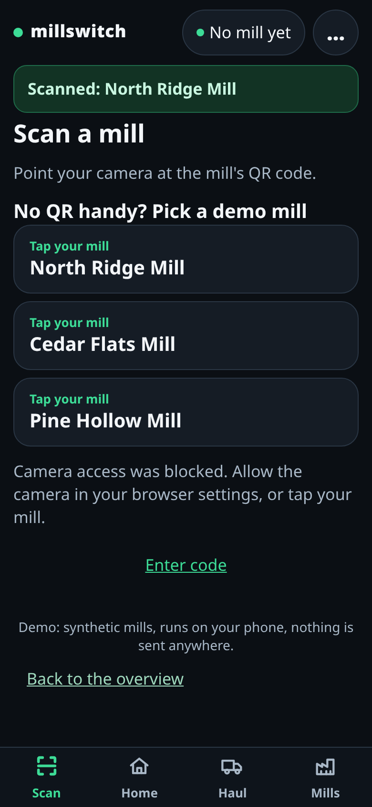

# MillSwitch

One driver app for every mill: scan in, haul, get credited, switch in one tap.

MillSwitch is a phone app for log-truck drivers who haul for several mills. Its code is private; this repo shows what it does and how it connects to a mill system.

## What it does for a driver

- **One sign-in, many mills.** The driver signs in once. Each mill relationship is separate: the mill issues that driver a signed, short-lived invite, so the mill decides who joins, and the mill can remove a driver later.
- **Scan in.** Scanning the mill's invite QR code redeems it. The app hands over the invite together with the driver's sign-in token, and the mill returns a token that works for that mill only.
- **Haul.** Each load is recorded as a pending ticket for the active mill.
- **Get credited.** A load stays pending until the mill's scale weighs it; then it is scaled, and the scaled ticket is the record that counts. The mill can also reject a load. Credited weight is the sum of scaled net weight, shown in the mill's own unit.
- **Switch in one tap.** Every mill the driver has joined is in one list, with today's loads and credited weight; tap one to make it active. Each mill keeps its own loads.
- **Works with no signal.** Loads recorded out of signal are queued on the phone and sent when it reconnects. Each load carries an id made on the phone, so a retry never creates a second ticket.

## Try it on your phone

Open <https://pebcrow.com/millswitch>. The app and its synthetic demo mills run in the phone browser, with no install and nothing sent anywhere. No QR handy? Pick a demo mill.

## Screens

The demo GIF shows five screens in order: scan, join, record a load, home, your mills.

| Scan | Join | Haul | Home | Mills |
|---|---|---|---|---|
|  |  |  |  |  |

## Connecting to a mill system

MillSwitch plugs into an existing mill or scale-house system through one small adapter and a sign-in hook. See [docs/adapter-design.md](docs/adapter-design.md).

## Code access on request

The code is private. Code access on request: contact Pebcrow Inc. at https://pebcrow.com/pebcrow_contact.

Built by the [Pebcrow Guild](https://pebcrow.com/guild).

## Disclaimer

All mills, drivers and loads shown are synthetic.

## License

Copyright (c) 2026 Pebcrow Inc. All rights reserved. See [LICENSE](LICENSE).
