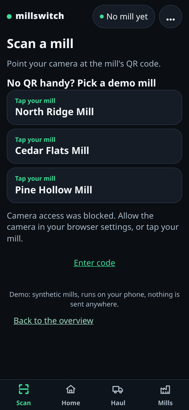
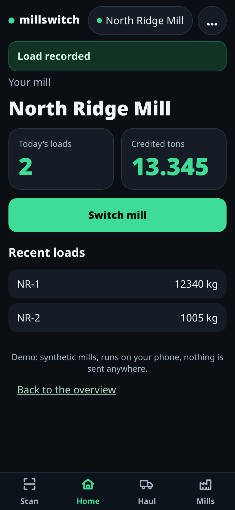
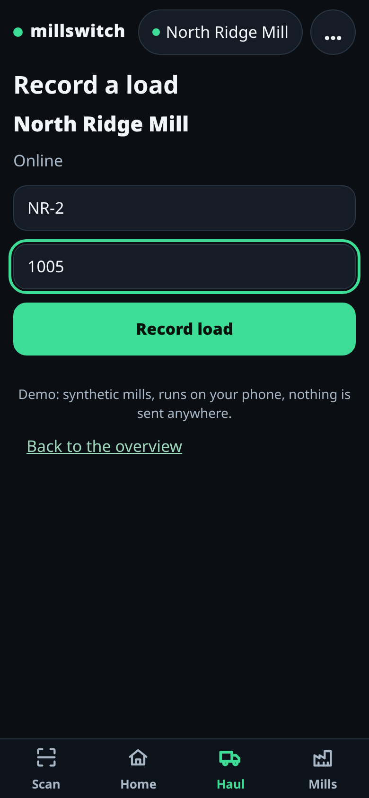
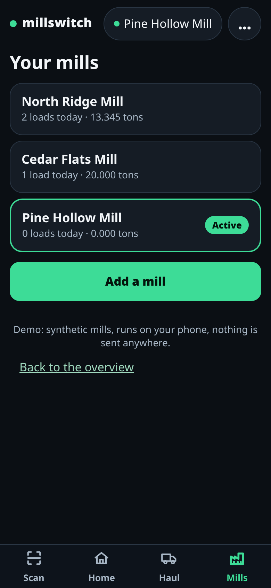

# MillSwitch

One driver app for every mill: scan in, haul, get credited, switch in one tap.

MillSwitch is a phone app for log-truck drivers who haul for several mills. Its code is private; this repo shows what it does, how it was built, and how it connects to a mill system.

## What it does for a driver

- **Scan in.** Point the camera at a mill's QR code and you are a member of that mill.
- **Haul.** Deliver loads as usual.
- **Get credited.** Each load shows up as credited tons for the mill it went to.
- **Switch in one tap.** Every mill you have joined is in one list, with today's loads and tons; tap one to make it active.
- **Works with no signal.** Loads recorded in the woods are queued and sent when the phone is back online.

## Try it on your phone

Open <https://pebcrow.com/millswitch>. The app and its synthetic demo mills run in the phone browser, with no install and nothing sent anywhere. No QR handy? Pick a demo mill.

## Screens

The demo GIF shows four screens in order: scan, home, haul, mills.

| Scan | Home | Haul | Mills |
|---|---|---|---|
|  |  |  |  |

## Connecting to a mill system

MillSwitch plugs into an existing mill or scale-house system through one adapter. See [docs/adapter-design.md](docs/adapter-design.md).

## How it was built

MillSwitch was built by the Pebcrow guild, a set of automated workers. The work was split into small work items (beads) under one epic. Each claim (a written promise about what the project delivers) has an automated check, and every bead's change landed through an automated test run.

| Measure | Number |
|---|---|
| Build time | about 5 hours of wall clock, one day (first app commit to latest app change) |
| Commits | 22 in the app repo (20 landed through bead lanes; the other 2 set up the repo and its test run) |
| Beads | 19 under one epic, 12 of them in the app repo (the rest are the website page and this showcase) |
| Claims | 18 proposed, 17 approved, 1 declined (scope dropped) |
| Tests | 64 test cases in 23 files (Vitest unit tests and Playwright phone-flow tests) |
| Review rounds | an adversarial review of the app (4 must-fix: 3 fixed, 1 withdrawn; 8 should-fix) and a fresh review of what is published |
| Demo mills | 3 synthetic mills, one QR code each |

## Code access on request

The code is private. Code access on request: contact Pebcrow Inc. at https://pebcrow.com/pebcrow_contact.

## Disclaimer

All mills, drivers and loads shown are synthetic.

## License

Copyright (c) 2026 Pebcrow Inc. All rights reserved. See [LICENSE](LICENSE).
